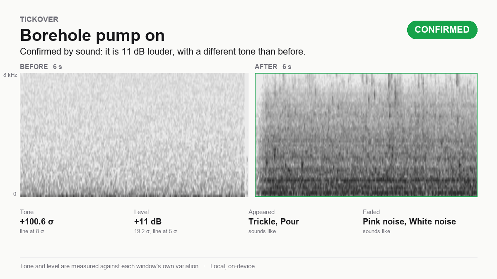
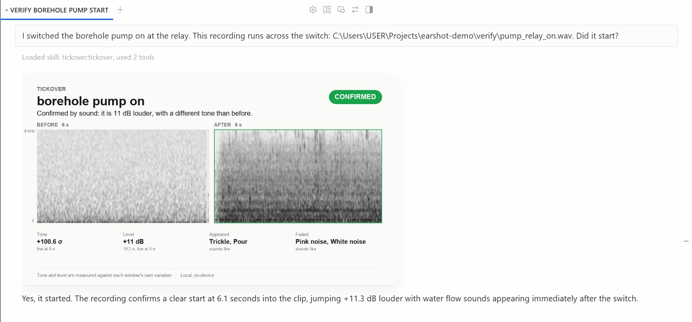

# Tickover

**Hermes can switch things on. Now it can hear whether they started.**

An agent that acts on the physical world works blind. It flips a relay, runs a job, moves an arm, and trusts the return code. Tickover gives Hermes ears. It listens before and after an action and says whether the sound changed. It remembers how a machine sounds when healthy and says when that drifts. It runs on the computer Hermes runs on, with no keys and no cloud.



```
You     I switched the borehole pump on at the relay. This recording runs across the switch.
Hermes  CONFIRMED. The sound got 11 dB louder at 6.1 s and the tone changed. The pump started.
You     An hour later I switched it on again. Same microphone.
Hermes  NO CHANGE. The level moved 0.4 dB. The action may not have reached the pump,
        or the microphone cannot hear it. I would check the relay.
```

Tickover is what mechanics call an engine at idle.

## Install

```bash
hermes plugins install rapha18th/tickover --enable
```

Prove it works on your computer, with synthetic sound and no recordings:

```bash
python -m tickover_core selftest
```

The first run downloads one 87 MB listening model. After that, nothing leaves the computer.

Optional: `pip install sounddevice` to use this computer's microphone.

On chat platforms, voice notes go to speech-to-text by default. For machine sound, send the recording as a file, or set `stt.enabled: false` in the profile you use for Tickover.

## What Hermes can do with ears

| The question | The tool | Setup |
|---|---|---|
| What is this sound? Is the recording usable? | `tickover_hear` | none |
| I switched something. Did it happen? | `tickover_verify` | none |
| Does this machine still sound like itself? | `tickover_enroll`, then `tickover_check` | 3 healthy recordings |
| Keep an ear on it. | `tickover_watch`, `tickover_checkin` | a schedule |
| Tell the repairer when it changes. | `tickover_watch` with `notify` | a chat id |
| How are all my machines? | `tickover_fleet` | none |
| Loaded or idle? Dry or wet? | `tickover_teach` (experimental) | 5 recordings per state |
| Listen now. | `tickover_listen` | a microphone |
| Does it work here? | `tickover_selftest` | none |

A skill (`skills/tickover/SKILL.md`) teaches Hermes when to reach for each tool and how to read the result.

Input: WAV, FLAC, OGG and Opus voice notes, M4A, MP3, MP4 video, a folder or glob, or an `rtsp://` or `http://` stream. ffmpeg is bundled through `imageio-ffmpeg`.

### Verify an action

Three steps, around any tool that acts.

1. `tickover_verify(step="before")` captures a few seconds.
2. Hermes runs the action: a smart plug, a relay, a shell command, a robot move.
3. `tickover_verify(step="after", expect="start")` captures again and compares.

One recording with the action inside it works too: `step="clip"`.



The verdict is `confirmed`, `no_change`, `other_change` or `unclear`. It comes with the level change in dB, the tone change in sigmas of the sound's own variation, what appeared or faded, and a card. Verify needs no baseline and no enrollment.

### Remember a machine

Enroll three or more healthy recordings of about 10 seconds. A phone voice note is enough. Every later recording gets a verdict: how far it sits from that machine's own normal, which frequency band moved, and a card that shows where.

A first `drift` is unconfirmed. Tickover asks for a second recording before it tells anyone to act. A bad recording gets `retake` with the fix, and nothing is scored.

### Keep an ear on it

`tickover_watch` puts a machine on a Hermes cron schedule.

- **With a person.** Hermes asks for a recording on schedule. The next voice note is checked, and the reply carries the trend and a forecast.
- **Unattended.** Give the watch a `source`: a camera stream, or a file that a recorder keeps fresh. Hermes checks it alone and speaks only when the sound changed. If the recorder stops writing, Hermes says the microphone needs attention.

`bridge/tickover_bridge.py` turns an old Android phone, a Raspberry Pi with a USB microphone, or any spare computer into a listening device. One file, standard library only. It prints the URL to give Hermes:

```
You     Watch the borehole pump from http://192.168.1.20:8765/clip?key=CHOOSE_ONE every morning at 7.
```

`/clip` records on demand, so the same URL serves `tickover_verify` before and after. `/latest` serves a clip the device records on a timer. If the device stops recording or stops answering, Hermes says so. Setup for each device is in [bridge/README.md](bridge/README.md). A recorder app that saves into a synced folder also works as a source.

`tickover_fleet` answers "how are my machines?" with one card.

### Tell the person who fixes it

Old machines change their sound before they fail. Tickover hears the change early. Name the repairer once and they hear it too, while the fix is still small.

```
You     Tell Tendai, our pump technician, on Telegram if the borehole pump changes.
        His chat id is 123456789.
Hermes  Done. Tendai hears only a confirmed change, with the card, once per change.
        Healthy checks stay silent.
```

When two recordings in a row agree that the pump drifted, Tendai gets this on Telegram:

```
Hello Tendai.
Tickover is listening to borehole pump (pump) at Mazowe farm for Chipo. Its sound has changed.
It is 4.1 times further from its own healthy sound than its normal day-to-day variation.
Under 2 is normal. 3 and above is a real change.
The change is strongest in the 3.9-8 kHz band.
Trend: +1.3 sigma per week over the last 5 check-ins.
A second recording confirmed it.
Please inspect it while the fix is still small. The diagnosis is yours.
Reply to Chipo directly. This bot does not read replies.
[the card]
```

`tickover_watch(machine, notify="telegram:123456789", notify_name="Tendai, pump technician")` sets it up. Any Hermes channel works: `whatsapp:+263771234567`, `email:tech@example.com`, `discord:<id>`. The same drift is sent once. A healthy check resets it. Only the owner, in their own chat, can change who is told.

- **Telegram.** The repairer opens your Hermes bot and presses Start, or the bot cannot write to them. They get their chat id by sending any message to @userinfobot.
- **WhatsApp.** Their number with the country code.
- **Email.** Their address.

### Extend it without code

Hermes is an agent, so the plugin grows by conversation.

- A new machine: enroll it.
- A new question: teach it.
- A new source: any path or stream URL.
- A new reaction: a cron job or a skill that reads `verdict` and `trend.escalate` and calls any other tool.

## Benchmarks

Every number below comes from a script in `bench/` and public recordings. Results are in `bench/*.json`.

### Verify

20 trials per case. Machine sound is from DCASE 2020 pump and fan recordings. Room tone is synthetic pink noise at -50 dBFS. Starts and stops are spliced from those two, so real rooms will be harder.

| Case | Before and after | One clip |
|---|---|---|
| Room tone to pump, confirmed | 20/20 | 20/20 |
| Pump to room tone, confirmed | 20/20 | 20/20 |
| Room tone to fan, confirmed | 20/20 | 20/20 |
| Fan to room tone, confirmed | 20/20 | 20/20 |
| A second machine starts beside a running fan, confirmed | 17/20 | 16/20 |
| A second machine stops beside a running fan, confirmed | 17/20 | 16/20 |
| **Nothing switched, room tone. False change** | **0/20** | **0/60** |
| Nothing switched, pump running. False change | 0/20 | 0/20 |
| Nothing switched, fan running. False change | 1/20 | 1/20 |

Limits, measured:

- **Use one microphone in one place.** Two different recordings of the same pump in the same state read as a change 2 times in 20. For the fan, 7 in 20. Before and after must come from the same session.
- **Verify does not find faults.** A normal pump against an abnormal pump reads as a change 2 or 3 times in 12. That job belongs to `tickover_check`.
- **Leave room around the action.** A clip needs 9 seconds, with 4 seconds on each side of the change. A change closer to the edge returns `unclear`.
- Verify hears that the sound changed. A person confirms what changed.

### Drift

Few-shot: the machine is enrolled from k healthy clips, then scored on labelled test recordings.

**Car engines, phone recordings.** 83 healthy and 238 faulty clips from seven car models (HF `RashmiKarunarathne/MyDataSet`). Enrollment uses healthy clips from any car, so these numbers understate a single-machine baseline.

| Fault | k=3 | k=5 | k=10 |
|---|---|---|---|
| Belt | 0.965 | 0.960 | **0.980** |
| Tappet | 0.764 | 0.810 | **0.870** |
| Misfire | 0.700 | 0.770 | **0.810** |

AUC, ten enrollments per setting. The cross-car baseline raises false alarms: 7% at k=10, 19% at k=3. Enroll your own machine with ten clips or more.

**DCASE 2024 Task 2 evaluation set.** Robot arm, hovering drone, brushless motor, 3D printer and air compressor. Matched condition, 100 test clips per machine, half anomalous. These anomalies are subtle by design. With the full 990-clip training sets, the 2024 challenge field reached official scores near 0.62.

| System | k=3 | k=5 | k=10 | false drift at 3σ, k=10 |
|---|---|---|---|---|
| **Tickover (ensemble)** | **0.560** | **0.562** | **0.586** | 2.4% |
| CED band bank alone | 0.503 | 0.549 | 0.558 | 2.5% |
| mn10 clip match | 0.543 | 0.526 | 0.564 | 7.7% |
| mn10 frame match | 0.558 | 0.553 | 0.572 | 2.1% |

Mean AUC, five enrollments per setting.

**Same machine, same condition.** Grouping the DCASE test clips by machine id and operating condition gives the setting Tickover is built for.

| Machine | k=3 | k=5 |
|---|---|---|
| Hovering drone | 0.757 | 0.755 |
| Brushless motor | 0.566 | 0.733 |
| 3D printer | 0.623 | 0.645 |
| Robot arm | 0.489 | 0.535 |
| Air compressor | 0.510 | 0.500 |
| **All** | 0.548 | **0.597** |

Tickover is strong on loud, obvious change: a belt, a misfire, a machine that stopped. It is weak on the subtle factory anomalies DCASE designs. Read the tables before you rely on it.

### Teach (experimental)

`tickover_teach` learns named states from a few recordings. It tests itself by holding out one recording at a time, and it switches on only when the result could not be luck. Mostly it stays off.

Ten random draws per question, scored on recordings it never saw:

| Question | Recordings per state | Switched on | Right when on | Wrong label when on |
|---|---|---|---|---|
| Any question | 3 | 0 of 90 draws | | |
| Drone speed, 2 states | 5 | 5 of 10 | 70 of 80 | 0 |
| Pump or fan | 5 | 2 of 10 | 26 of 32 | 3 |
| Car engine fault, 4 states | 5 | 2 of 10 | 44 of 64 | 1 |
| 3D printer, robot arm, compressor, pump fault, fan fault | 5 | 0 of 10 each | | |

The answers that are neither right nor wrong are `uncertain` or `unknown`. Treat teach as a preview.

## How it works

Tickover follows the training-free systems at the top of the DCASE Task 2 challenge: frozen pretrained audio encoders, a memory bank of healthy sound, nearest-neighbour distance, and an ensemble.

1. **Two encoders.** CED-base, a ViT distilled on AudioSet (Apache-2.0, mispeech), turns each clip into a grid of tokens over time and four frequency bands. EfficientAT mn10, a MobileNetV3 distilled on AudioSet (MIT), adds per-frame embeddings. Both run in onnxruntime on CPU.
2. **Three scores.** A CED band bank with mean pooling and relative deviation pooling. An mn10 clip match by cosine. An mn10 frame match at the 90th percentile, so brief events count.
3. **Self-calibration.** Every healthy clip is scored against the others. Each score becomes robust sigmas (median and MAD) against that spread, and drift is their mean. Under 2 sigma reads healthy. 2 to 3 reads watch. 3 and above reads drift.
4. **Verify.** The same embeddings, compared between two windows instead of against a baseline. Level and tone each move in sigmas of the windows' own variation. In one clip, a search finds the split that separates the two sides best.
5. **Quality gate.** Clipping, silence, speech and wind are caught before scoring. The answer is `retake`, with the fix.

A check takes about 0.6 s on a laptop CPU.

## Scope

Tickover detects change. It names the band that moved, and Hermes suggests where to look. It never names a fault. The diagnosis stays with a person. Record from the same spot and distance each time. A new microphone position reads as change.

## Data and network

- First use downloads CED-base (87 MB) from Hugging Face, `mispeech/ced-base` at a pinned commit, and checks its sha256. Every other step runs offline.
- `tickover_core/models/mn10_frames.onnx` (12 MB) ships with the plugin, pinned by sha256. `scripts/export_mn10.py` rebuilds it.
- Audio stays on the machine. The microphone opens only during `tickover_listen` and a microphone `tickover_verify`.
- Baselines and history live in Hermes's plugin data folder (`plugin-data/tickover`).

## Credits

CED (Dinkel et al., mispeech, Apache-2.0). EfficientAT (Schmid et al., MIT). Injini (rapha18th, MIT). DCASE 2020 and 2024 Task 2 data (CC BY-NC-SA 4.0, evaluation only). Method: BEAM (Saengthong and Shinozaki, 2026), relative deviation pooling (Wilkinghoff, Yadav and Tan, 2026).

MIT License.
