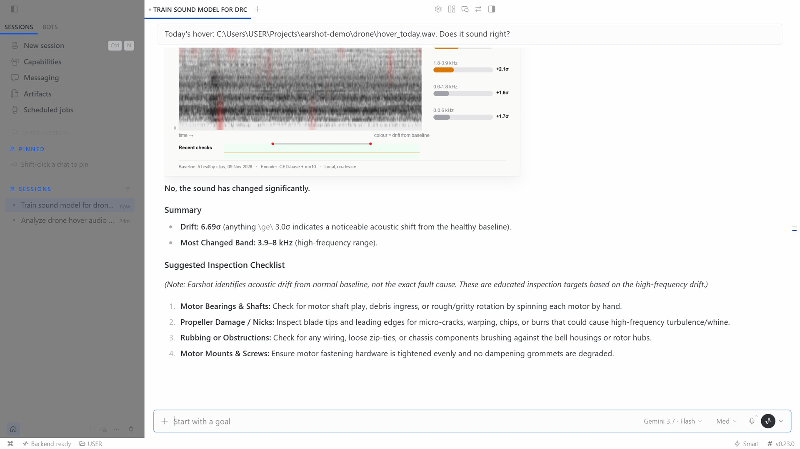

# Earshot

**Hermes can hear when a machine changes.**

Robots, drones, printers, fans, pumps and engines announce trouble in sound first. Earshot gives Hermes that sense. Record a machine while it is healthy, a phone voice note is enough, and Earshot learns its sound. Every later recording gets a verdict: how far it sits from that machine's own normal, which frequency bands moved, and a card that shows where.



```
You     [sends healthy recordings of the car at idle]
Hermes  Enrolled 11 healthy clips. Earshot now knows how "Car engine" sounds.
You     [a new recording]
Hermes  DRIFT. 5.2 sigma from its healthy self, rising across every band, most in 3.9-8 kHz.
        A broadband, rhythmic change at idle fits a misfire. Check plugs and coils first.
        MEDIA:/.../check.png
```

## Tools

| Tool | What it does |
|---|---|
| `earshot_enroll(machine, paths, append?)` | Learns a machine from 3+ healthy clips of about 10 s, or one recording of 30 s or more. |
| `earshot_check(machine, path)` | Scores a recording against that machine. Returns `drift_sigma`, the bands that moved, and a PNG card. |
| `earshot_listen(seconds, machine, then)` | Records from this computer's microphone, then enrolls or checks. For the fan in your PC, the printer on your desk, the robot on your bench. |
| `earshot_status(machine?)` | Lists machines and their check history. |

Accepted input: anything ffmpeg reads (Telegram and WhatsApp voice notes, m4a, mp4 video), plus WAV, FLAC and OGG through soundfile.

A skill (`skills/earshot/SKILL.md`) teaches Hermes the flow and how to read a result.

## Install

```bash
hermes plugins install rapha18th/earshot --enable
```

Optional microphone support: `pip install sounddevice`. Optional formats: install ffmpeg.

Check it works, with synthetic machine sound and no recordings:

```bash
python -m earshot_core selftest
```

On chat platforms, voice notes go to speech-to-text by default. For machine sound, send the recording as a file, or set `stt.enabled: false` in the profile you use for Earshot.

## How it works

Earshot follows the training-free systems at the top of the DCASE Task 2 challenge (machine anomalous sound detection, 2024 to 2026): frozen pretrained audio encoders, a memory bank of healthy sound, nearest-neighbour distance, and an ensemble across different encoders.

1. **Two encoders.** CED-base, a ViT distilled on AudioSet (Apache-2.0, mispeech), turns each clip into a grid of tokens over time and four frequency bands. EfficientAT mn10, a MobileNetV3 distilled on AudioSet (MIT), adds per-frame embeddings. That is the encoder from Injini, our earlier on-device engine monitor. Both run in onnxruntime on CPU.
2. **Three scores.**
   - CED band bank: per band, mean pooling plus relative deviation pooling, which keeps a single click visible (Wilkinghoff et al., 2026). One nearest neighbour per band (BEAM, Saengthong et al., 2026).
   - mn10 clip match: nearest healthy clip by cosine.
   - mn10 frame match: the 90th percentile of each frame's distance to its nearest healthy frame.
3. **Self-calibration.** Every healthy clip is scored against the others. Each score becomes robust sigmas (median and MAD) against that spread, and drift is their mean. The number reads the same for a drone and a diesel: how unusual this sound is for this machine.
4. **Where it changed.** Each time-frequency token is matched against the healthy tokens of its band. That map colours the card and names the band that moved.

Thresholds: under 2 sigma reads healthy, 2 to 3 reads watch, 3 and above reads drift. A check takes about 0.6 s on a laptop CPU. Enrolling ten clips takes about 5 s.

## Benchmarks

Few-shot: the machine is enrolled from k healthy clips, then scored on labelled test recordings. Five random enrollments per setting. Scripts in `bench/`.

**DCASE 2024 Task 2 evaluation set, embodiment machines.** Robot arm, hovering drone, brushless motor, 3D printer and air compressor. Matched condition (source domain), 100 test clips per machine, half anomalous. These anomalies are subtle by design. With the full 990-clip training sets, the 2024 challenge field reached official scores near 0.62.

| System | k=3 | k=5 | k=10 | false drift at 3σ, k=10 |
|---|---|---|---|---|
| **Earshot (ensemble)** | **0.560** | **0.562** | **0.586** | 2.4% |
| CED band bank alone | 0.503 | 0.549 | 0.558 | 2.5% |
| mn10 clip match (Injini) | 0.543 | 0.526 | 0.564 | 7.7% |
| mn10 frame match | 0.558 | 0.553 | 0.572 | 2.1% |

Mean AUC. At k=10, Earshot reaches 0.703 on the 3D printer, 0.677 on the drone and 0.563 on the robot arm.

**Same machine, same condition.** The DCASE labels record each test clip's machine and operating condition (drone id, speed, microphone, motor load, printer model). Grouping by those labels gives the setting Earshot is built for: enroll k normal clips of one machine in one condition, then score its other normals and its anomalies.

| Machine | k=3 | k=5 |
|---|---|---|
| Hovering drone | 0.757 | 0.755 |
| Brushless motor | 0.566 | 0.733 |
| 3D printer | 0.623 | 0.645 |
| Robot arm | 0.489 | 0.535 |
| Air compressor | 0.510 | 0.500 |
| **All** | 0.548 | **0.597** |

Mean AUC over condition groups, five enrollments each.

**Car engines, phone recordings.** 83 healthy and 238 faulty clips from seven car models (HF `RashmiKarunarathne/MyDataSet`). Enrollment uses healthy clips from any car, so these numbers understate a real single-machine baseline.

| Fault | Earshot k=3 | k=5 | k=10 | mn10 alone, k=10 |
|---|---|---|---|---|
| Belt | 0.965 | 0.960 | **0.980** | 0.960 |
| Tappet | 0.764 | 0.810 | **0.870** | 0.809 |
| Misfire | 0.700 | 0.770 | **0.810** | 0.793 |

AUC, ten enrollments per setting. The cross-car baseline raises false alarms: 7% at k=10, 19% at k=3. Enroll your own machine with ten clips or more.

## Scope

Earshot detects change against one machine's own normal. It names the band, and Hermes suggests where to look. The diagnosis stays with a person. Record from the same spot and distance each time. Microphone changes and new background noise read as drift.

## Data and network

- First use downloads CED-base (87 MB) from Hugging Face, `mispeech/ced-base` at a pinned commit, checks its sha256, and stores it in the plugin data folder. Every other step runs offline.
- `earshot_core/models/mn10_frames.onnx` (12 MB) ships with the plugin, pinned by sha256. `scripts/export_mn10.py` rebuilds it from the Injini and EfficientAT sources.
- Audio stays on the machine. The microphone opens only during `earshot_listen`.
- Machine baselines and check history live in Hermes's plugin data folder (`plugin-data/earshot`).

## Credits

CED (Dinkel et al., mispeech, Apache-2.0). EfficientAT (Schmid et al., MIT). Injini (rapha18th, MIT). DCASE 2024 Task 2 data (Nishida et al., CC BY-NC-SA 4.0, used for evaluation only). Method: BEAM (Saengthong and Shinozaki, 2026), relative deviation pooling (Wilkinghoff, Yadav and Tan, 2026).

MIT License.
